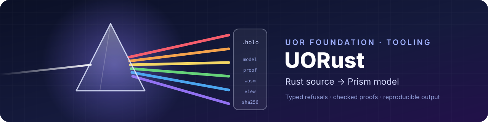
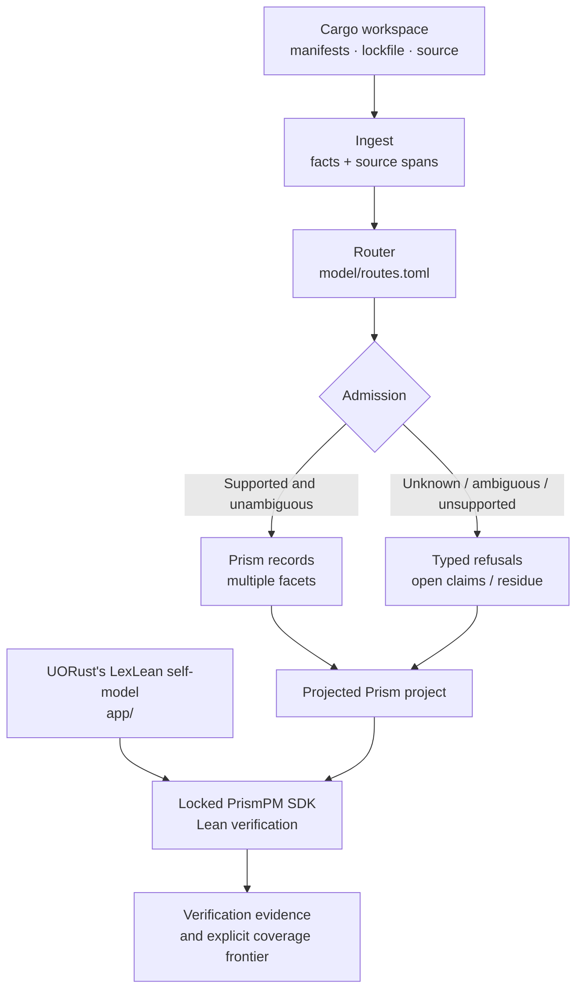

<p align="center">
  <a href="https://afflom.github.io/UORust/">
    
  </a>
</p>

<h1 align="center">UORust</h1>

<p align="center"><strong>Source code changes. Architecture documentation and verification claims can drift.</strong></p>

<p align="center">UORust turns a Cargo workspace into a source-linked, reviewable Prism model. It separates what is actually modeled or verified from what remains unsupported, so gaps stay visible instead of becoming accidental assurances.</p>

<p align="center">
  <a href="https://github.com/UOR-Foundation/UORust/actions/workflows/bootstrap.yml"></a>
  <a href="https://github.com/UOR-Foundation/UORust/actions/workflows/pages.yml"></a>
  <a href="https://github.com/UOR-Foundation/UORust/releases/latest"></a>
  <a href="Cargo.toml"></a>
  <a href="LICENSE-MIT"></a>
</p>

<p align="center">
  <a href="https://afflom.github.io/UORust/"><strong>Try the live route table</strong></a> ·
  <a href="#quick-start"><strong>Quick start</strong></a> ·
  <a href="https://github.com/UOR-Foundation/UORust/releases/latest"><strong>Releases</strong></a> ·
  <a href="#architecture"><strong>Architecture</strong></a> ·
  <a href="#documentation-and-repository-map"><strong>Documentation</strong></a> ·
  <a href="CONFORMANCE.md"><strong>Conformance evidence</strong></a>
</p>

> **Scope:** UORust can emit a Prism project for a Cargo workspace, but **not every Rust function or effect is yet translated into a proved behavioral definition**. Unsupported semantics are recorded as residue, foreign dependencies, effects, or open claims. The [current lift register](frontier.toml) and [conformance register](CONFORMANCE.md) are the evidence, not a blanket claim of complete verification.

## Contents

- [Why UORust](#why-uorust)
- [What UORust does](#what-uorust-does)
- [Try the live demo](#try-the-live-demo)
- [Quick start](#quick-start)
- [Install and supported platforms](#install-and-supported-platforms)
- [Architecture](#architecture)
- [What the project contains](#what-the-project-contains)
- [Routing and explicit refusals](#routing-and-explicit-refusals)
- [Self-model and formal verification](#self-model-and-formal-verification)
- [Maturity, evidence, and limitations](#maturity-evidence-and-limitations)
- [Development and acceptance](#development-and-acceptance)
- [Releases and provenance](#releases-and-provenance)
- [Documentation and repository map](#documentation-and-repository-map)
- [Contributing and governance](#contributing-and-governance)
- [License](#license)

## Why UORust

A codebase can change while its diagrams, design notes, and proof claims stay frozen in time. That mismatch makes it harder to tell **what the repository actually contains**, **what its verification covers**, and **which assumptions still need work**. UORust aims to reduce that distance by deriving a model from the code and making its evidence and unsupported cases inspectable.

This is particularly useful for developers reviewing unfamiliar Rust code, maintainers tracking architectural drift, and teams that need a reproducible handoff between implementation and formal modeling. **It is not a replacement for design decisions, independent audits, or tests.**

## What UORust does

UORust is a Rust command-line tool that reads Cargo workspace metadata, manifests, the lockfile, and source syntax to create a [Prism](https://github.com/UOR-Foundation/PrismPM) project. The generated project describes software from multiple angles: architecture, design, features, behavior, security, quality, and release evidence.

Its core contract is **route, admit, or refuse**, not guess. A fact with a supported and unambiguous route becomes a model record. A fact that cannot be classified or translated is made visible in the resulting evidence. Generated files are designed to be reproducible: `uorust check` compares an existing projection against the source workspace.

| If you want to… | Start here |
| --- | --- |
| See the basic routing decision in action | [Browser-based route-table demo](https://afflom.github.io/UORust/) |
| Generate a model from Rust | [Quick start](#quick-start) and `uorust project` |
| Check whether a projection is current | `uorust check` and the [locked SDK](prismpm.lock) |
| Understand what is actually proved | [Conformance evidence](CONFORMANCE.md), [lift register](frontier.toml), and [verification](#self-model-and-formal-verification) |
| Work on the engine or submit a fix | [Contributing and governance](#contributing-and-governance) |

**Key properties**

- **Multi-facet projection:** one output project containing architecture, design, features, behavior, security, quality, and release descriptions.
- **Source-linked findings:** the model and registers retain references to the facts, spans, and identities behind their claims.
- **Typed refusal instead of silent fallback:** unsupported or ambiguous inputs do not acquire an invented meaning.
- **Measured proof frontier:** lifted, unlifted, foreign, and effect-bound behavior is distinguished in the [frontier register](frontier.toml).
- **Locked verification:** the repository uses [PrismPM](https://github.com/UOR-Foundation/PrismPM) and [LexLean](https://github.com/UOR-Foundation/LexLean) through the SDK selected by [`prismpm.lock`](prismpm.lock).

## Try the live demo

**[Open the UORust route table](https://afflom.github.io/UORust/)**. Enter a Rust fact kind such as `pub-fn`, `error-enum`, or `unsafe-block`. The page runs the project's verified routing application and shows the destination record and facet, or an explicit refusal.

For example:

```text
Input:  error-enum
Result: route UR-R12
        fact error-enum
        record LexLean.inductive
        facet behavior
```

The [route table](model/routes.toml) is shared by the [Rust router](crates/uorust/src/route.rs) and the [LexLean model](app/src/Routes.lex.tex). They replay common acceptance vectors.

**What the demo is not:** it is not a browser-based full-Cargo-workspace translator or an end-to-end proof of an arbitrary Rust program. Use the CLI and SDK for the complete projection workflow.

## Quick start

### 1. Get the CLI

The reproducible path from a tagged source release is:

```sh
cargo install --locked --git https://github.com/UOR-Foundation/UORust --tag v0.4.0 uorust
uorust --version
```

You can instead use a platform archive from the [latest release](https://github.com/UOR-Foundation/UORust/releases/latest). The tagged example above intentionally pins a version; the release page is the source of truth for newer versions.

### 2. Generate a Prism project

Run these commands with a local Cargo workspace in place of `path/to/workspace`:

```sh
uorust project path/to/workspace --out path/to/prism-project
uorust check path/to/workspace --out path/to/prism-project
```

`project` writes the output; `check` verifies the output still matches the workspace. The engine uses offline Cargo metadata, so the workspace dependencies must be available locally.

### 3. Verify its model

From the [digest-pinned PrismPM SDK environment](prismpm.lock):

```sh
prismpm --project path/to/prism-project check
```

A Prism project can contain open claims or unlifted behavior. Successful validation of its structure is **not** a proof that all source behavior was translated or certified. Inspect its generated registers and verification results.

**Working from this repository instead of installing the CLI:**

```sh
git clone https://github.com/UOR-Foundation/UORust.git
cd UORust
cargo run --locked -p uorust -- routes
cargo run --locked -p uorust -- project path/to/workspace --out path/to/prism-project
```

The workspace declares **Rust 1.89** as its minimum version and pins **Rust 1.97.1** in [`rust-toolchain.toml`](rust-toolchain.toml) for repository development.

## Install and supported platforms

| Route | When to use it | Availability / qualification |
| --- | --- | --- |
| [GitHub release archives](https://github.com/UOR-Foundation/UORust/releases/latest) | Download a prebuilt binary and verify its digest and provenance | Check the exact assets on the release page |
| [Tagged Cargo source](https://github.com/UOR-Foundation/UORust/releases/tag/v0.4.0) | Reproduce a known source version | `cargo install --locked --git … --tag v0.4.0 uorust` |
| [Install scripts](install.sh) / [Windows script](install.ps1) | Scripted installation | Read the scripts before executing; they use published release assets |
| [Homebrew formula](Formula/uorust.rb) | macOS/Linux package management | Formula is generated from release checksums; verify it targets the desired release |
| [Nix flake](flake.nix) | Build from the pinned Nix configuration | `nix run github:UOR-Foundation/UORust -- --version` |
| [crates.io package](https://crates.io/crates/uorust) / [cargo-binstall](https://github.com/cargo-bins/cargo-binstall) | Registry-based installation | Only after the package/version is published in the registry |

**Windows note:** Windows is included in the release build matrix, but it is a *non-blocking* target. The published [v0.4.0 assets](https://github.com/UOR-Foundation/UORust/releases/tag/v0.4.0) include Linux and macOS archives, **not** a Windows archive. Do not assume a Windows binary is attached to every release.

For exact supported commands, conditional registry publication, and checks, see [`install.yml`](.github/workflows/install.yml) and [`release.yml`](.github/workflows/release.yml). Environment overrides for the install scripts include `UORUST_VERSION` and `UORUST_INSTALL_DIR`.

## Architecture

UORust follows the [Foundry](https://github.com/UOR-Foundation/foundry) pattern: propose a route, admit only supported evidence, then emit a checked projection.



| Boundary | Role | Authoritative sources |
| --- | --- | --- |
| Ingest and source identity | Read the workspace and preserve the origin of facts | [`ingest.rs`](crates/uorust/src/ingest.rs), [`facts.rs`](crates/uorust/src/facts.rs) |
| Routing | Determine the record kind and model facet | [`model/routes.toml`](model/routes.toml), [`route.rs`](crates/uorust/src/route.rs) |
| Admission and projection | Construct accepted records and expose refusal evidence | [`admit.rs`](crates/uorust/src/admit.rs), [`project.rs`](crates/uorust/src/project.rs) |
| Rust-to-LexLean behavior | Translate supported Rust behavior; retain residue for unsupported cases | [`lift.rs`](crates/uorust/src/lift.rs), [`frontier.toml`](frontier.toml) |
| Formal model | Define UORust's own model and route-table application | [`app/`](app), [`Routes.lex.tex`](app/src/Routes.lex.tex) |
| Acceptance | Validate locks, model, reproducibility, tests, proof and dependencies | [`Justfile`](Justfile), [`VERIFICATION.md`](VERIFICATION.md) |

The self-model and generated workspace projections are related, but distinct: proof of UORust's router does not automatically prove every program being modeled.

## What the project contains

An output projection includes the Prism project configuration (`prismpm.toml` and `lexlean.toml`), facet modules and evidence describing admitted Rust facts. Depending on the source and selected workflow, the engine also reports lifted definitions and what remains outside the current proof frontier.

| Model facet | The questions it addresses |
| --- | --- |
| Architecture | What components, concerns, stakeholders, and dependencies exist? |
| Design | How do components, processes, calls, and states relate? |
| Features | What functions, interfaces, tests, and journeys are represented? |
| Behavior | Which functions are expressed as LexLean definitions, and which cannot yet be lifted? |
| Security | What capabilities, unsafe boundaries, threats, risks, and controls are observable? |
| Quality | Which quality requirements, lints, measurements, and portability constraints are present? |
| Release | Which packages, artifacts, and release properties are represented? |

These are modeling facets, **not promises that every real-world property can be inferred from source alone**. A generated model remains inspectable and its open claims remain visible.

## Routing and explicit refusals

The canonical [`model/routes.toml`](model/routes.toml) defines all route IDs, fact kinds, output record types, facets, and shared acceptance vectors. A few representative examples:

| Rust fact kind | Prism record | Facet |
| --- | --- | --- |
| `crate-bin-target` | `Foundation.Arch::Component` | Architecture |
| `pub-fn` | `Feature.calls` | Features |
| `error-enum` | `LexLean.inductive` | Behavior |
| `unsafe-block` | `Foundation.Sec::Threat` | Security |
| `lock-package` | `System.SpdxPackage` | Release |
| `state-enum` | `Foundation.Arch::UmlState` | Design |

Each request is a set of fact-classification tags, one per line. Two tags naming different routes are **ambiguous**, not silently assigned one route. Unknown kinds are refused; empty, oversized, invalid UTF-8, and blank-line requests return explicit errors.

The complete and up-to-date catalog belongs in the [route source](model/routes.toml), rather than a second manually maintained copy in this README. Both implementations are checked against that source by the conformance tests.

## Self-model and formal verification

UORust models its own architecture, feature journeys, behavior, security controls, quality requirements, design views, and release process in [`app/src/`](app/src). The live page is one application of that model, using the verified route table.

| Area | Model entrypoint |
| --- | --- |
| Architecture and relationships | [Architecture.lex.tex](app/src/Architecture.lex.tex) |
| Design and interactions | [Design.lex.tex](app/src/Design.lex.tex) |
| Features and journeys | [Features.lex.tex](app/src/Features.lex.tex) |
| Routing behavior and proofs | [Routes.lex.tex](app/src/Routes.lex.tex) |
| Security, threats, and controls | [Security.lex.tex](app/src/Security.lex.tex) |
| Quality requirements | [Quality.lex.tex](app/src/Quality.lex.tex) |
| Release and distribution | [Release.lex.tex](app/src/Release.lex.tex) |
| Page guide and response frame | [Guide.lex.tex](app/src/Guide.lex.tex), [Frame.lex.tex](app/src/Frame.lex.tex) |

The repository's [self-model generators](scripts/self-model) bind model records to source spans and identities. [Conformance tests](crates/conformance/tests/self_model.rs) reject drift. The locked SDK checks the applicable model, theorem, build and dependency contracts; generated projection coverage must still be assessed independently.

## Maturity, evidence, and limitations

| Boundary | What can be claimed | Where to verify |
| --- | --- | --- |
| Released | Versioned binaries and checksums exist for the platforms attached to a published release | [GitHub releases](https://github.com/UOR-Foundation/UORust/releases), [release workflow](.github/workflows/release.yml) |
| Enforced on PRs | The repository's acceptance command runs inside a locked SDK on PR CI | [Bootstrap workflow](.github/workflows/bootstrap.yml), [`just vv`](Justfile) |
| Modeled and checked | The registered routes, model facets, tests and specified proof claims have their corresponding verification paths | [CONFORMANCE.md](CONFORMANCE.md), [app/](app) |
| Measured, not complete | Not all source functions lift; residual, foreign and effect cases remain accounted for | [frontier.toml](frontier.toml), [lift verdicts](lift-verdicts.toml) |
| Under active development | More source constructs, foreign models, MIR semantics and certified translation are being integrated | [Open pull requests](https://github.com/UOR-Foundation/UORust/pulls), [open issues](https://github.com/UOR-Foundation/UORust/issues) |

A passing build or model check certifies **the checks it actually ran**, not an arbitrary Rust program's total correctness. There is no hidden fallback that upgrades a refusal into a verified claim.

## Development and acceptance

The acceptance boundary is **`just vv`**, executed inside the exact SDK image selected by [`prismpm.lock`](prismpm.lock). The [devcontainer](.devcontainer/devcontainer.json) and [bootstrap workflow](.github/workflows/bootstrap.yml) provide the canonical environments.

| Command | Purpose |
| --- | --- |
| `just vv` | Complete acceptance: formatting, model and template checks, self-model drift, Clippy, tests, dependency policy, app proof and UORust projection checks |
| `just app` | Check, build and verify UORust's LexLean model and application |
| `just model-write` | Regenerate [CONFORMANCE.md](CONFORMANCE.md) from the capability registers |
| `just self-model-write` | Regenerate the route-table and facet model outputs from their authoritative inputs |
| `just self-model-check` | Refuse drift in the committed self-model and generated artifacts |
| `just register` | Refresh the [lift frontier](frontier.toml) while refusing previously lifted functions that are no longer lifted |
| `just new-capability <ID> <level> <suite> "<statement>"` | Register a capability with its scenario and initial failing test |

For CI evidence see [Actions](https://github.com/UOR-Foundation/UORust/actions); for the precise contract, [VERIFICATION.md](VERIFICATION.md), [TEMPLATE-CONTRACT.md](TEMPLATE-CONTRACT.md), and [AGENTS.md](AGENTS.md).

**Do not** substitute a passing partial Rust test command for `just vv`. When an external SDK or platform dependency is unavailable, report that as a blocked verification leg, not as a successful full run.

## Releases and provenance

The most recent release verified for this README is **[v0.4.0](https://github.com/UOR-Foundation/UORust/releases/tag/v0.4.0)**. Releases contain archives, individual archive hashes, and `SHA256SUMS`. Build-provenance attestations are attached to qualifying release builds.

### Release targets

The following is **generated by [`scripts/self-model/release.py`](scripts/self-model/release.py)** from the release workflow. Do not hand-edit this marked block; `just self-model-check` verifies its contents.

<!-- release-targets:begin (scripts/self-model/release.py) -->
| Target | Archive | Built on | Release waits for it |
| --- | --- | --- | --- |
| `x86_64-unknown-linux-gnu` | `uorust-x86_64-unknown-linux-gnu.tar.gz` | `ubuntu-24.04` | yes |
| `aarch64-unknown-linux-gnu` | `uorust-aarch64-unknown-linux-gnu.tar.gz` | `ubuntu-24.04-arm` | yes |
| `x86_64-apple-darwin` | `uorust-x86_64-apple-darwin.tar.gz` | `macos-15` | yes |
| `aarch64-apple-darwin` | `uorust-aarch64-apple-darwin.tar.gz` | `macos-15` | yes |
| `x86_64-pc-windows-msvc` | `uorust-x86_64-pc-windows-msvc.zip` | `windows-2025` | no |
<!-- release-targets:end -->

A target marked *no* is non-blocking: a release may be published without its artifact. Always consult the release's actual asset list.

### Verify an archive

For a Linux x86-64 release, from a directory where you want to keep the downloaded artifacts:

```sh
gh release download v0.4.0 --repo UOR-Foundation/UORust \
  --pattern 'uorust-x86_64-unknown-linux-gnu.tar.gz' \
  --pattern SHA256SUMS

sha256sum --check --ignore-missing SHA256SUMS

gh attestation verify uorust-x86_64-unknown-linux-gnu.tar.gz \
  --repo UOR-Foundation/UORust \
  --signer-workflow afflom/UORust/.github/workflows/release.yml
```

The hash check validates downloaded bytes against the release's checksum list; the GitHub attestation verifies the artifact's signed build provenance. The historical `v0.4.0` signer identity uses the former `afflom/UORust` repository name because that release predates the move. Neither replaces validation of the model you generate from your own workspace.

## Documentation and repository map

| Where | What to find |
| --- | --- |
| [`crates/uorust/`](crates/uorust) | Rust CLI, ingest, routing, admission, behavior lifting, projection, tests |
| [`app/`](app) | UORust's own LexLean/Prism model and verified application |
| [`model/`](model) | Route table, capability IDs, authority, comparator and ledger registers |
| [`features/suites/`](features/suites) | Registered behavioral acceptance scenarios |
| [`crates/conformance/`](crates/conformance) | Repository and self-model conformance tests |
| [`crates/certified/`](crates/certified) | Generated/certified translator artifacts and manifests |
| [`site/`](site) and [`try/`](try) | Browser-facing route-table page and try experience |
| [`.github/workflows/`](.github/workflows) | Acceptance, Pages, release, installation, generation, certification workflows |

**Reference documents**

- [CONFORMANCE.md](CONFORMANCE.md): generated capability and acceptance evidence.
- [VERIFICATION.md](VERIFICATION.md): universal acceptance and SDK contract.
- [TEMPLATE-CONTRACT.md](TEMPLATE-CONTRACT.md): template-owned versus project-owned authority boundaries.
- [TEMPLATE-VERIFICATION.md](TEMPLATE-VERIFICATION.md): template's falsifiable verification evidence.
- [LANES.md](LANES.md): contributor and machine-lane workflow for evaluator development.
- [AGENTS.md](AGENTS.md): governing instructions for agents and contributors.
- [PrismPM documentation](https://github.com/UOR-Foundation/PrismPM/tree/main/docs/site): model format, facets and SDK.
- [LexLean](https://github.com/UOR-Foundation/LexLean): the model language and proof compilation toolchain.

## Contributing and governance

We welcome bug reports, reproduction cases, documentation improvements, and source-to-model coverage work. Start with [issues](https://github.com/UOR-Foundation/UORust/issues) and [pull requests](https://github.com/UOR-Foundation/UORust/pulls).

This repository follows [`uor/template-contract/1`](TEMPLATE-CONTRACT.md). Review [AGENTS.md](AGENTS.md) before changing behavior: new capabilities require registered IDs, acceptance scenarios and failing tests; generated evidence must be regenerated from its authoritative source; refusals must remain explicit. The full acceptance is `just vv` in the locked SDK. Do not modify the human-reviewed bootstrap trust root to make a proposed change pass.

For security-sensitive discoveries, avoid posting exploit details or secrets in a public issue. Use an appropriate private maintainer contact or GitHub's private vulnerability-reporting surface if it is enabled.

## License

Dual licensed under [MIT](LICENSE-MIT) **or** [Apache-2.0](LICENSE-APACHE), at your option.
